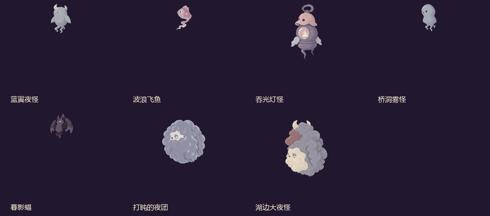
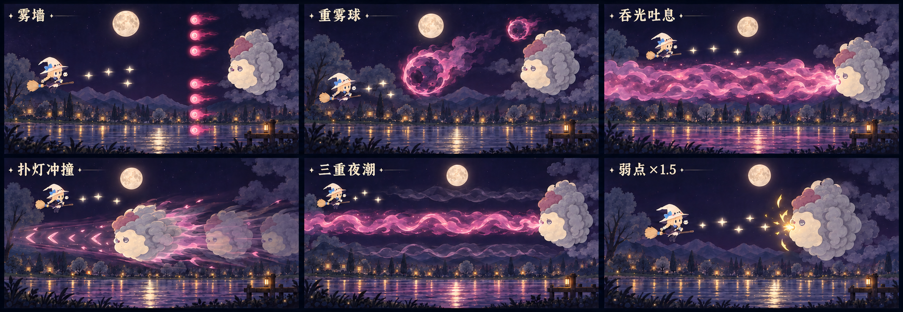
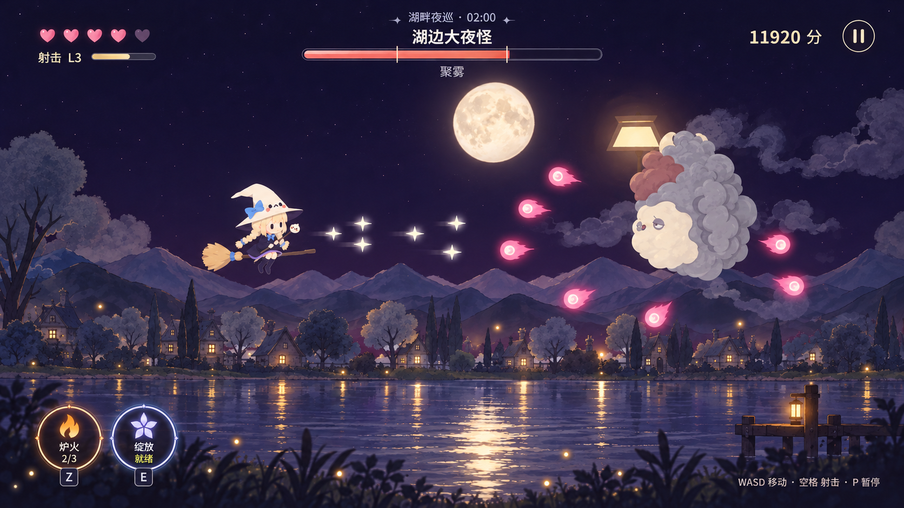

# 小魔女夜巡 · 第一关《湖畔夜巡》游戏策划案

版本 **v1.12.0** · 2026 年 10 月 24 日 · 完整整合版

适用：关卡、程序、美术、动画、音效、界面与测试。工程资源按本资料包的分类目录浏览。

本文件保留 2026 年 10 月 24 日 v1.12.0 的完整设计基准；实现状态描述属于当时的记录。公开整理于 2026 年 10 月 28 日，未重新验收游戏。当前素材见本资料包分类目录。

本版射击表采用 1.0 / 1.2 / 1.4 的主弹伤害基准；该表是设计基准。爱心采用“远处主动漂近、近处加速接取”方案。

## 1 游戏定位与故事

### 1.1 一句话介绍

小魔女每晚骑扫帚沿湖巡一圈，用星光赶走夜里滋生的怪物，收拢萤火后回家。

天黑后，村外的暗影会聚成小夜怪：有的在窗边扑腾，有的藏在桥洞，有的抱着暖光晃来晃去。小魔女认识村里的每一扇窗，晚饭后就戴上软帽出门，让大家安心睡觉。怪物被驱散后变回柔软夜雾，第一关的事情只发生在这个普通夜晚。

故事通过暖窗、湖面、石桥、路灯和归途表现。村民无需在关卡中对话；玩家的直接目标是处理前方夜怪和躲避攻击。

| 项目 | 执行定义 |
| --- | --- |
| 类型 | 向右自动推进的横版飞行射击；角色在屏内自由上下左右移动 |
| 关卡 | ST01 · 湖畔夜巡 |
| 平台 | 桌面键鼠、手机横屏、平板横屏 |
| 时长 | 约两分半；以约 160 秒为调校中心，常规观察区间约 150–170 秒；Boss 用时和末波收尾可浮动 |
| 推进 | 六阶段顺序；路线按局部时钟，Boss 按击破事件，归途按十秒奖励段 |
| 成功 | 生命大于 0，驱散两名 Boss，完成归途和飞出演出 |
| 失败 | 生命归零 |
| 初始状态 | 5/5 生命、射击 L1、成长 0、炉火 0/3、绽放 0/100、得分 0 |
| 主要内容 | 一名主角、五种小怪、两名 Boss、星屑射击、炉火、星光绽放、六处场景构图、完整菜单与双端 UI |

时长是节奏指标。战斗按实际状态完成，不设置全关倒计时失败；Boss 仍存活时继续战斗。

### 1.2 核心循环

移动换线并持续射击 → 击破夜怪 → 微光自动回收、射击成长、绽放充能 → 击破灯怪补充炉火 → 在危险或输出窗口主动使用炉火、绽放 → 击破 Boss → 收拢萤火回家。

第一遍游玩需要读懂三件事：白色星弹是自己的攻击；橙色炉火来自灯怪；绽放能量满后可以获得五秒更强射击和五秒无敌。普通射击足以推进关卡，技能提供救场与加速输出机会。

## 2 小魔女与表现基准

### 2.1 文字形象

主角是头大身小的 Q 版小女孩，骑坐在近乎水平的扫帚上，身体为正面偏右的四分之三视角。浅金齐刘海，两条蓬松麻花辫垂在两侧，辫梢系蓝色小结；眼睛是简洁的黑色竖椭圆，肤色柔暖，脸颊淡粉，神情安静。

奶油白尖顶软帽占整体轮廓较大比例，帽尖向左弯垂，宽帽檐内侧深紫。帽身有黑色小方眼、折线嘴和粉红脸颊的表情纹样，左侧固定较大的蓝色蝴蝶结。深紫宽袖连衣裙配蓝色领结、浅紫裙边和深紫长靴；双膝并拢，自然垂在扫帚同一侧。

双手握棕色细柄魔杖，杖身左下至右上，奶白猫脸杖头位于脸的右侧。扫帚木柄朝右，左端是麦金草束，以蓝色束带扎紧。大软帽、蓝结、金辫、猫脸杖头和横向扫帚是缩小后仍需保留的识别点。

### 2.2 动画与挂点

沿用当前工程的飞行、横移、射击、施法、绽放和前飞加速图集。动画播放不改变移动上限、生命或碰撞半径。

| 状态 | 表现与事件 |
| --- | --- |
| 悬停飞行 | 8 fps 往返循环；帽尖、辫梢、裙摆和帚尾轻摆，躯干稳定 |
| 移动 | 12 fps 往返循环；根据水平与垂直速度轻量倾斜，不把整个人拉长 |
| 连续射击 | 12 fps 射击段；依据实际开火状态选择，键盘连射与触控自动连射共用条件 |
| 炉火 | 抬杖和回落，焰流起点贴当前杖头；整段可移动，表现与判定一起跟随 |
| 绽放 | 轻量抬杖、边光、短弧和帚尾；主体衣帽颜色、脸和眼睛保持清楚 |
| 前飞加速 | 右移达到现行触发条件后播起手与循环；是移动动画，不另设技能或额外无敌 |
| 有效受伤 | 小幅失衡与受伤闪烁；生命 UI 始终可见 |
| 成功离场 | 约 0.62 秒后撤蓄力，再向右加速飞出；飞出后进入成功页 |

角色锚点为躯干中心附近，初始 (100,133)。普通主弹出点为锚点右 20、下 2；侧弹出点为右 18、上 6 / 下 10。角色帧位移与杖头光点应共用挂点数据。

## 3 坐标、移动与通用判定

### 3.1 逻辑世界

逻辑画布为 480×270，左上原点，x 向右、y 向下。本案中的速度、距离、半径与坐标均为逻辑像素；UI 尺寸另标 CSS 像素。

| 项目 | 数值与规则 |
| --- | --- |
| 战斗中玩家中心范围 | x 28–335；y 43–225 |
| 归途玩家中心范围 | x 28–428；y 43–225 |
| 移动上限 | 水平 160/秒；垂直 155/秒；斜向输入归一化 |
| 响应 | 约 0.08 秒平滑响应，停止输入后快速收速 |
| 小怪出生 | 首只 x=500；编队在屏外建立后飞入 |
| 普通离场 | 沿原运动飞走后删除，无击破奖励；当前回收边界 x<−70，异常越界同样回收 |
| 场景碰撞 | 房屋、湖面、桥梁、树与路灯均为背景层，没有战斗碰撞 |

镜头保持向前飞行的视差，玩家屏内位置不拖动关卡镜头。环境构图应让桥柱与岸景读成背景，避免用完全不透明的前景墙挡住可通行区域。

### 3.2 生命与碰撞

| 对象 / 事件 | 判定基准 |
| --- | --- |
| 玩家受击核心 | 半径 9，位于角色锚点；帽尖、扫帚和辫子不全算受击范围 |
| 普通敌弹 / 火团 | 半径 3；与玩家中心距离小于 12 时相交 |
| 普通怪接触 | 中心距离小于 19；有效碰撞扣 1 生命，普通怪消除且无奖励 |
| Boss 接触 / 冲撞 | 现行合并接触阈值 36；冲撞用连续扫掠判定 |
| 重雾球接触 | 球半径 10，与玩家核心合并为 19 |
| 玩家星弹 | 普通半径 4；绽放半径 6 |
| 敌方受弹半径 | 小怪 11；中 Boss 22；大夜怪 30；重雾球 10 |
| 吐息 / 夜潮 | 真实危险带与玩家核心相交；预兆本身无伤害 |

有效受伤减 1 生命，获得 1.5 秒受伤无敌，射击成长、炉火与绽放充能保留。普通敌弹与重雾球接触无敌玩家时消失但不扣血；绽放期间与普通怪接触不把它撞死。

快速星弹、蝙蝠俯冲和 Boss 冲撞都需检查两帧之间的运动线段，含玩家本帧位移，避免低帧率擦边漏判。单次碰撞和击破只结算一次。生命归零立即失败，后续拾取与奖励不复活玩家。

### 3.3 状态与时间

| 状态 | 移动 | 新射击 / 炉火 / 新绽放 | 已有绽放 | 回收与危险 |
| --- | --- | --- | --- | --- |
| 开场准备 3 秒 | 可 | 关闭 | 不存在 | 不刷怪、不生成攻击 |
| 普通战斗 / 桥下收尾 | 可 | 正常 | 正常扣时 | 正常回收与危险 |
| PH04 四秒预警 | 可 | 关闭 | 正常扣时 | 旧拾取继续；没有旧小怪危险 |
| Boss 战内换阶段 0.70 秒 | 可 | 可攻击存活 Boss | 正常扣时 | 旧攻击当步关闭；Boss 不回填、不锁血 |
| Boss 击破过渡 0.80 秒 | 可 | 关闭 | 中 Boss 后继续扣时；最终 Boss 击破时结束 | 战斗危险关闭；有效奖励保留，残留支援怪无奖励退场 |
| PH06 归途 | 可 | 关闭 | 已结束 | 只接萤火，没有伤害 |
| 暂停 / 失焦 / 页面隐藏 | 冻结 | 不接受 | 冻结 | 物体、波次、奖励飞行和有效计时冻结 |

Boss 战内换阶段与 Boss 击破后的离场是两种不同状态。前者保留对存活目标的输出，后者关闭战斗伤害，不能在庆祝击破时被残留小怪撞死。

## 4 普通射击与成长

### 4.1 星屑射击

桌面按住空格或 J 连射；触控战斗中自动连射。每 0.15 秒发射一轮，速度 380/秒，寿命 1.4 秒，不消耗资源。普通攻击与移动、炉火、绽放并行。

| 等级 | 累计微光 | 每轮弹数 | 主弹伤害 | 每颗侧弹伤害 | 侧弹偏角 |
| --- | --- | --- | --- | --- | --- |
| L1 | 0 | 1 | 1.0 | 0 | 0 |
| L2 | 22 | 3 | 1.2 | 0.2 | ±0.04 弧度 |
| L3 | 82 | 3 | 1.4 | 0.3 | ±0.07 弧度 |

L2 起呈三路持续射击；升级不依赖场上物体，也不因接取补给消失。每颗微光成长 +1，累计到阈值立即升阶，生命受损不降级。L3 时成长条保持满格并读成满级。

星弹使用暖白星形、淡青短尾，主弹比侧弹清楚；发射瞬间杖头短亮。每轮射击只播放一次对应射击音，连续射击音量低于敌方预兆音。击中最近有效交点后消失；绽放弹按第 6 章处理穿透。

本表为待回调的执行基准。现行工程的主弹为 2.0 / 2.4 / 2.8、侧弹为 0 / 0.4 / 0.6，属于核对记录中的数值偏差，不能把倍率验证的任意输入当作修改射击表的依据。

### 4.2 成长与资源分工

微光：射击成长、绽放充能、基础分数。炉火火种：炉火库存。爱心：生命。萤火：归途分数。每种资源有固定形状和明确去向。

升级时在角色旁出现一次“射击 L2 / L3”，左上数字与条同步变化；不弹出阻断战斗的说明。三路弹道出现后保持稳定，玩家无需记额外切换操作。

## 5 炉火

### 5.1 使用、来源与伤害

技能按钮名为“炉火”，库存 0–3，开局 0。桌面 Z、触屏点炉火按钮；成功施放消耗 1 次，施放间隔 1.00 秒。无库存输入只反馈“击败灯怪补充炉火”，不预约下一次自动施放。

玩家有效击破吞光灯怪时获得 1 份炉火奖励。库存与在途预约合计最多 3，满额奖励转 100 分。微光、爱心、Boss 奖励和等待时间各按自己的用途结算。

| 项目 | 规则 |
| --- | --- |
| 持续 | 1.00 秒，可移动、可继续普通射击 |
| 结算 | 0、0.12、0.24、0.36、0.48、0.60、0.72、0.84 秒，共八段 |
| 单段伤害 | 每个有效目标 2 点；全中通常 16 点 |
| 范围 | 角色前方至右侧视口，目标中心与角色当前高度差不超过 18；重雾球考虑自身半径 |
| 贯穿 | 不被前排小怪阻断，范围内目标分别结算 |
| 清弹 | 八段分别清理焰流带内的普通敌弹、灯怪火团与雾墙弹滴 |
| 重雾球 | 正常承受每段伤害，HP 归零才消散 |
| 吞光灯怪 | 免疫火焰，伤害 0；星弹和绽放星弹可伤害 |
| 弱点 Boss | 命中弱点状态时每段 3 点，八段都处于窗口时合计 24 点 |

每段以当时角色位置与 Boss 弱点状态结算，移动能调整焰流高度。火焰表现也随同一挂点移动，覆盖最后一次伤害到结束的时间，不出现“火在旧位置，伤害在新位置”或火光提前消失。

### 5.2 灯怪耐火反馈

火焰触及灯肚时沿壳边分开，化为两三颗短火星，局部短显“耐火”约 0.5 秒；每只灯怪同一秒最多提示一次。免疫不触发白闪、受伤音或新的蓄火反击，也不回血、不反射。炉火正常消耗，仍能攻击它身后其他目标。

### 5.3 火种飞入与到账

灯怪被有效击破 → 灯肚原地亮 0.10 秒 → 火种沿 0.60 秒短弧飞向**当前炉火按钮内的火焰图标中心** → 抵达时库存 +1，按钮短亮 0.18 秒，数字轻跳，按钮旁显示“炉火 +1”。火种不先飞向角色，也不飞向背景路灯。

火种使用唯一奖励 ID，在击破时预约容量；到达时只入账一次。满额当场转分，避免播放假的加库存动画。飞行中施放炉火不会重抽已判定的奖励去向。

起点保存为可重映射的世界 / 容器坐标，终点每帧读取真实图标位置。暂停冻结飞行；旋转、换手和布局变化后仍对准当前按钮。失败取消在途奖励，重开和回标题清空 DOM、队列与预约。进入归途前结清已经登记的有效奖励，再收起技能组。

背景路灯可以在到账后次级变暖，但资源反馈以飞入按钮为主，不占顶部战斗提示。

### 5.4 炉火视觉与声音

焰流用橙金亮芯、深赭暗部、柔软火舌和少量上扬火星。保持暖火形状，与敌方玫紫夜雾区分。能量主体贴合真实焰流带，外侧暖晕低透明，敌弹轮廓与 Boss 危险边界位于它上方。

施放只播一次展开声；八段命中可用低音量短灼烧声并节流。全程随技能计时收束，最后一段之后只保留与真实结束匹配的短消散，不额外制造伤害。

## 6 星光绽放

### 6.1 充能与开启

按钮简称“绽放”。初始能量 0，上限 100；满后由玩家主动开启，桌面 E / K，触屏点按钮。满槽不自动触发，持续中重复输入不重开、不延长、不预约。

| 事件 | 能量 |
| --- | --- |
| 非持续态回收一颗微光 | +5 |
| 非持续态对任一 Boss 造成真实生命损失 | 每 1 点损失 +0.5；保留小数，含弱点倍率 |
| 过量伤害 | 只按命中前剩余 HP 计真实损失 |
| 伤害小怪 / 重雾球本身 | 不直接充能；小怪微光回收按微光规则 |
| 绽放持续中 | 不积累下一轮能量；微光仍给成长与分数 |
| 阶段切换 | 剩余能量保留，最终 Boss 击破时战斗充能关闭 |

### 6.2 五秒统一状态

开启消耗 100 能量，立即获得五秒星弹强化和五秒无敌。攻击强化、无敌、角色持续特效、声音状态与 UI 倒计时共用一个剩余时间，同步开始、同步结束。暂停冻结该时间；预警与换阶段不额外延长。

| 效果 | 执行规则 |
| --- | --- |
| 射击伤害 | 新生成星弹伤害 ×1.5，侧弹同样受益 |
| 星弹尺寸 | 碰撞半径 4→6；视觉加强但保留中心与短尾 |
| 普通怪穿透 | 一颗弹最多依次命中两只普通怪，同一实例仅一次；命中 Boss 或重雾球后终止 |
| 开启清弹 | 仅成功开启那一刻，清角色周围半径 56 的普通敌弹一次 |
| 无敌 | 敌弹、灯怪火团、小怪接触、Boss 接触、重雾球、吐息、冲撞、夜潮均不扣血 |
| 炉火 | 可同时使用，按炉火自身伤害结算；Boss 弱点倍率仍适用 |
| 结束 | 能量从 0 重新积累；已有弹保留生成时属性直到命中或消失 |

正常受伤无敌与绽放无敌分别管理。绽放本身结束时不额外追加保护；此前真实受伤的独立计时不用于驱动技能时长。

### 6.3 专属特效

| 环节 | 时序与表现 |
| --- | --- |
| 开启 | 0–0.18 秒抬杖和星芒展开；薄断环可以到 0.32 秒完成展开，强化与无敌从开启当步就有效 |
| 持续 | 角色淡边光、四段短弧、短帚尾和稀疏星屑；护膜填充透明度不超过 0.10，脸和受击位置始终清楚 |
| 命中 | 真正交点出现小星芒与碎光，局部反馈 0.16 秒左右，不把整个敌人盖白 |
| 穿透 | 首次命中在出口留短星梭 / 断环，弹继续飞；第二次普通怪命中收束；同一目标不反复闪 |
| 结束预告 | 最后 0.50 秒短弧与帚尾收紧；倒计时与条同步减少 |
| 结束 | 剩余时间归零当步关掉角色护膜、持续星光与强化状态，不留会被误读为仍受保护的尾圈 |

装饰粒子上限建议桌面 36、触屏 18；命中 / 穿透组同时桌面 6、触屏 3，生成间隔至少 0.06 秒。危险区域外扩 6 内减少或停止新装饰，包含吐息、夜潮、冲撞航道、敌弹和重球。敌方预兆与真实危险边界优先显示。

## 7 道具、生命与得分

### 7.1 道具表

| 名称 | 文字形象 | 来源 | 回收 / 效果 |
| --- | --- | --- | --- |
| 微光 | 暖白小光滴，淡青短尾；不是敌方圆弹 | 一般小怪 1；灯怪 2；教学 2；中 Boss 10；最终 Boss 14 | 一般掉落短散开 0.12 秒后自动回收，最长 1.8 秒兜底；每颗成长 +1、非持续态能量 +5、20 分 |
| 炉火火种 | 橙金火苗与短暖尾 | 玩家有效击破灯怪 | 直接飞往炉火图标；到账 +1 次，满额 100 分 |
| 灯芯分数物 | 圆形小灯芯，蓝白火苗，体积小于火种 | 灯怪固定一枚 | 自动回收，100 分 |
| 回血爱心 | 粉红心形、奶白清楚描边、小暖晕，约 14×12 | 满足条件的飞鱼 / 雾怪随机掉落 | 主动漂近，接取生命 +1，封顶 5；掉落后已满血则 100 分 |
| 萤火 | 小暖核加两片短翅，与敌弹形状不同 | PH06 固定 24 只 | 归途移动接取 / 近距吸附，每只 200 分 |

道具不受攻击、不挡弹，触碰敌人或场景不会被销毁。Boss 微光在有效击破事务中一次结算；之后飞向角色的光迹只是表现，不二次入账。

### 7.2 回血爱心

飞鱼有效击破时掉率 8%，桥洞雾怪 12%。只在玩家缺血、当前没有另一颗爱心、本关成功生成数未到 3 时判定；每个怪物 UID 一次，不补判、不转移概率。PH01、PH03 为当前掉落战斗段。

生成即占本关额度，过期未捡也计入 3 颗上限。接触消除、离场、转场清理不给掉落。随机掉率不保证每局都有爱心；中 Boss 击破固定回复 1 生命独立保留。

爱心寿命 8 秒。远处以 88/秒向玩家漂近，距离 80 内加速到 220/秒，距离 24 内直接接取；接近步长跨过目标时直接结算，避免来回抖动。它走独立更新分支，寿命与移动在暂停时冻结，跨桥下预警保留剩余寿命。接取不补充炉火、成长或绽放能量。

接取角色旁显示“生命 +1”，左上新恢复的一颗心短亮，播放柔和上行声；满血时显示“生命已满 +100”。重开清实体与计数，失败优先，不同帧补血不能把已经判失败的角色复活。

### 7.3 得分

| 事件 | 分数 |
| --- | --- |
| 一般小怪有效击破 | 100 |
| 灯怪有效击破 | 300 |
| 中 Boss / 最终 Boss | 1000 / 2500 |
| 微光 / 灯芯 | 20 / 100 |
| 炉火满额奖励 / 满血爱心 | 100 / 100 |
| 萤火 | 200；24 只最多 4800 |
| 成功剩余生命 | 每点 150，只结算一次 |

成功才更新本地最高成功分；失败局仍显示本局得分。存储不可用时保持可玩。得分、成长、库存分别记录，不能用一个“收集数”混算全部资源。

## 8 五种小怪

上图为当前工程图集首帧的核对图，方便确认形象，格内留白不表示游戏显示比例。

| ID / 类型 | 形象与辨识 | HP / 左飞速度 | 战斗职责 |
| --- | --- | --- | --- |
| EN01 imp · 蓝翼夜怪 | 灰蓝小雾身，头上两根短角，侧面软翼，下面拖几缕卷尾；眼神呆呆的 | 6 / 82 | 低压编队与换线教学；不发弹 |
| EN02 fish · 波浪飞鱼 | 暗粉鱼头、单只大眼和小鳍，身后是浅色扭曲雾尾 | 6 / 100 | 正弦波浪穿行；速度较快，诱导上下移动 |
| EN03 carrier · 吞光灯怪 | 像旧提灯与小茶炉合成的夜怪，粉灰盖头、顶部提环、圆肚内有暖火，短手与雾尾 | 10 / 45 | 炉火补给；受有效非致死星弹伤害后一次蓄火反击；耐火 |
| EN04 head · 桥洞雾怪 | 奶灰白小幽灵，黑色椭圆眼，圆头逐渐收成几缕雾脚 | 8 / 76 | 清楚预兆后向左发双弹，制造换高度间隙 |
| EN05 bat · 暮影蝠 | 深紫蝙蝠，尖耳、小眼、两片宽膜翼和卷曲短尾 | 6 / 平飞 90 | 逐只锁定玩家旧位置后俯冲，迫使及时离开锁线 |

### 8.1 编队与移动

同队从屏外依次进入：飞鱼、蝙蝠、灯怪横向间距 36，其他 30。蓝翼基础高度按 −18 / 0 / +18 错位；其他多只编队按现行上下错位生成，基础高度限制在可见飞行范围。相邻个体正弦相位差 0.5。

蓝翼上下轻摆约 6；飞鱼正弦幅度 28、角频率 3.5；灯怪轻摆 6；桥洞雾怪轻摆 4。身体大小用于绘制，受弹范围与接触范围按第 3 章独立定义。

### 8.2 吞光灯怪：受惊吐火

第一次受到有效非致死星弹伤害时准备反击，一生一次。入屏且玩家在它左方有至少 120 的水平距离才开始 0.65 秒预兆；灯肚发亮、盖头微抬。距离不足时取消待发计时，提前击破则整个反击取消。

发射点在灯肚偏左，向左扇形三火团，偏角 −0.25 / 0 / +0.25 弧度，速度 110，半径 3，寿命 5 秒。外观是橙红焰头、深红边与逆运动方向短尾；不要与粉紫普通弹、可接取火种混同。

Boss 吐息、冲撞、夜潮的预兆和危险期，不开始也不推进支援灯怪的新反击。恢复期重新核对距离后再蓄火，避免多个高压攻击同时压上来。

### 8.3 桥洞雾怪：桥洞双雾

进入 x≤430 后等待 0.40 秒，仍位于玩家右方至少 100 时开始 0.60 秒鼓腮预兆。发射两颗相互独立的世界坐标弹，位于自己中心 y±10，初始 x 在本体左侧。

两弹水平向左速度 136、vy=0、半径 3、寿命 5 秒，一生一次。怪物左飞 76，所以发射后 0.5 秒弹相对怪再向左拉开 30，1 秒拉开 60；不能画成挂在嘴边的局部光点。

### 8.4 暮影蝠：折翼俯冲

每只蝙蝠中心抵达 x≤430 且与玩家水平距离大于 120 时，独立开始一次 0.55 秒预兆。前 0.40 秒采样玩家位置，末 0.15 秒锁定旧位置并显示细锁线；之后速度 260，沿锁定直线飞到该点，再恢复左飞离场。

每只拥有自己的锁定点、向量与剩余距离，中途不追踪拐弯。距离不足则直接平飞。到点截断末帧步长，不越过目标，也不因夹住 y 边界改变俯冲方向。接触采用相对扫掠，不能只检查终点。

## 9 两名 Boss

### 9.1 打盹的夜团 · 中段 Boss

形象为几乎圆形的灰紫卷雾团，奶白小脸藏在前方，困倦眼神和小嘴；周围五枚小雾团缓慢环绕，属于装饰。HP 190，受弹半径 22，从右侧以 65/秒进入，驻留中心 x≈390。

使用固定 5.80 秒循环，交替移到中心 y=86 / 184。入场完成后开始循环：

| 循环秒数 | 行为与玩家应对 |
| --- | --- |
| 0.00–0.80 | 移到本轮高度，让出另一条高度通道 |
| 0.80–1.45 | 鼓腮蓄雾，锁定当时玩家位置；锁线与嘴部亮点提示 |
| 1.45 / 1.70 / 1.95 | 三连吐：相同固定方向，速度 84、半径 3；玩家离开旧锁线 |
| 1.95–3.20 | 恢复，可输出 |
| 3.20–3.85 | 五枚小雾团膨起，准备扇射 |
| 3.85 | 向左五向扇弹，偏角 ±0.72 / ±0.36 / 0，速度 65 |
| 3.85–5.80 | 恢复并进入下一轮 |

击破给 1000 分、10 微光，并回复 1 点生命，封顶 5。0.80 秒散雾过渡后进入桥下。中段 Boss 不使用大夜怪的弱点倍率或三阶段刻度。

### 9.2 湖边大夜怪 · 三阶段

灰紫卷雾堆成更高的侧身，奶白困倦脸朝左，头顶有暗粉雾结与浅色月牙状突起，身体外围慢转雾旋。动作应是吸雾、鼓起、收紧、扑出和松散，避免硬质机械碎块。

HP 320，受弹半径 30；驻留中心约 (401,133)，本体 w88、h96。所有阶段使用同一条血量，224 与 112 为阈值，血条刻度分别位于剩余血量 70% 与 35%。

| 阶段 | 生命范围 | 招式循环 | 本体变化 |
| --- | --- | --- | --- |
| F1 聚雾 | 224<HP≤320 | 夜雾横推 → 单重雾球 → 循环 | 雾团偏收拢，读缺口与可击破球 |
| F2 逐灯 | 112<HP≤224 | 扑灯冲撞 → 吞光吐息 → 夜雾横推 → 循环 | 两侧雾翼展开，动作幅度加大 |
| F3 夜潮 | 0<HP≤112 | 三重夜潮 → 双重雾球 → 扑灯冲撞 → 循环 | 额头雾结加深，内部雾线更紧 |

跨阈值当步取消旧待发与旧危险，散雾换形 0.70 秒，下一段从首招开始。一次伤害跨两道阈值则直接进入对应目标阶段；不补演中间段、不回填血量、不强制锁血。HP 归零以击破优先。

### 9.3 BS03 夜雾横推

0.85 秒预兆；右侧 x=410 出一列雾滴，候选 y=48–224、间隔 16。距离当前缺口中心不超过 40 的候选点不发弹。缺口按 y80 → y188 → y134 循环，全战接续。

弹滴向左 84/秒，半径 3，可被炉火和开启绽放的近身清弹处理。玩家通过清楚空缺换线。虚拟墙推进至 x<16 后切下一招，未消失的弹滴仍按自身生命处理，换阶段时统一清理。

### 9.4 BS04 重雾球

0.75 秒嘴边聚雾预兆，起始锁定玩家当时的位置。F1 在 0.75 秒发一球；F3 在 0.75 / 1.40 秒各发一球，两球朝同一旧目标点。发射后沿直线飞行，不持续追踪。

球速 90、半径 10、HP5，可用星弹与炉火击破；绽放开启的普通清弹不直接删除重球。末球发出至少 1.50 秒且本招重球均消失后再换招。

### 9.5 BS05 吞光吐息

预兆 1.15 秒，前 0.40 秒将**可见口部**对齐锁定高度，y 限制 80–188。危险带 x24–390、中心 y 为锁定高度、半高 22；危险持续 1.20 秒，随后恢复 1.80 秒并露出弱点。

整条危险带启动当步同时生效，内部向左流雾只表示方向；上、下区域可躲。可见嘴部、喷射起点、预兆、危险带和弱点裂光共用同一动画挂点，不能只移动光效而脸留在原高度。

### 9.6 BS06 扑灯冲撞

预兆 1.10 秒，锁定高度 y90–178；本体先压到该航道。中心从 x401 以 320/秒向左冲至 x110，约 0.91 秒。端点失衡 0.75 秒，再用 0.80 秒沿原航道返回，回位恢复 1.20 秒。

去程和回程本体均有接触危险，连续扫掠；航道和残影不增加额外判定。失衡与回位恢复是两个弱点窗口，回程不处于弱点。玩家看见锁道后换高度，回位再输出。

### 9.7 BS07 三重夜潮

三条水平潮带中心 y80 / y134 / y188，半高 14、x24–390。按以下顺序启动，一次只一条危险：

| 层 | 预兆开始 | 危险开始 | 危险结束 |
| --- | --- | --- | --- |
| 上 | 0.00 | 0.85 | 1.25 |
| 中 | 1.60 | 2.25 | 2.65 |
| 下 | 3.00 | 3.65 | 4.05 |

4.05 秒后恢复 1.40 秒，露出弱点，整招 5.45 秒。预兆能提前看出当前层；危险当步整带可见，不用逐渐推进的波头伪装判定起点。上下换线的空间保持暗而干净。

### 9.8 弱点与奖励

弱点期间 Boss 承受有效玩家伤害 ×1.5，按真正落伤时刻计算一次；不是只对某个脸部小像素生效。按本案 L1 星弹基准，普通 1→弱点 1.5；绽放 1.5→叠弱点 2.25。炉火每段 2→3，八段均处窗口时 16→24。

弱点窗口为吐息恢复 1.80 秒、冲撞端点失衡 0.75 秒、回位恢复 1.20 秒、夜潮恢复 1.40 秒。显示由真实窗口驱动，每次重新初始化本窗口起点；奶金口部裂光与“弱点 ×1.5”短签同步，结束当步关闭。短签每窗只出现一次，命中给局部金点，不全身高频刷白。

最终击破给 2500 分与 14 微光；当步停止战斗充能、结束绽放，清旧危险，播放 0.80 秒柔软散雾，再进入归途。

### 9.9 Boss 支援灯怪

全关固定路线灯怪 6 只；中 Boss 最多支援 1 只，大夜怪 F2 / F3 各最多 1 只，同屏最多一只支援。它们沿原灯怪逻辑飞行，不为技能库存而反复补刷。

中 Boss 战斗局部时间至少 5 秒后，在一个恢复窗口投放；大夜怪进入 F2 / F3 至少 1.2 秒后，在恢复窗口投放。高度选玩家远侧 y80 或 y188。高压招式的预兆、发动和 Boss 换阶段不投放，不推进灯怪反击；相应恢复窗口才允许。

如果高输出直接跨阶段，跳过阶段的支援不补发。支援怪有效击破给正常灯怪奖励；Boss 击破后还活着的支援无奖励退场，不能继续造成伤害。

## 10 大夜怪特效执行

上图为已生成的美术方向参考；当前工程已有相关特效素材。图的构图与光晕不能代替本案的真实判定尺寸、数量和缺口。

### 10.1 统一视觉语言

攻击主色暗紫 #49305F、玫紫 #C26AAB、淡粉边 #F4BDDF；弱点为奶金 #FFD98A。场景低对比，攻击实体有暗边和稳定轮廓，经过月亮也能读懂。危险期的边界不随雾纹忽明忽暗。

| 招式 | 预兆 | 危险 / 持续 | 命中与结束 |
| --- | --- | --- | --- |
| 夜雾横推 | 发射位置长出分离雾芽，缺口留空；连接雾丝避开空缺 | 独立雾滴有暗边、亮核、右向短尾；不连成封死通道的连续墙 | 本弹消失即关闭其判定，散 3–4 小雾片，约 0.12–0.18 秒淡出 |
| 重雾球 | 嘴边暗雾从空变实，短拉伸示意锁定方向 | 暗密核、3–5 片卷雾、淡粉外缘和短尾，双球尾迹不连成光束 | 小亮斑确认受击；HP0 后约 0.20 秒散去，无残留伤害 |
| 吞光吐息 | 收腹吸雾，真危险带上下边界低亮，浅底从嘴到左端完整提示 | 整带连贯紫底与向左短雾纹；真实上下边缘稳定，不能用纹理空白假装安全 | 结束当步停危险，主带断开约 0.18 秒消退；恢复切金色口部裂光 |
| 扑灯冲撞 | 本体压低、雾翼后拉；两条轻薄航道边和少量左向箭纹 | 本体轮廓清楚，逆运动方向短尾和最多 2 道无判定残影；回程仍读得出危险本体 | 端点局部松雾、失衡；回位收尾，不用整屏白光掩盖位置 |
| 三重夜潮 | 只预热当前层，薄边与少量雾纹；下一层不提前铺实底 | 当前层整带同时可见，稳定边缘和流动内纹；最多一条危险 | 每层危险结束后 0.15 秒残雾消散且无伤害；三层结束进入弱点 |
| 弱点 | 可见口部雾壳松开，奶金漏光 | 四段短弧、小金屑、“弱点 ×1.5”；与同一个真实窗口绑定 | 局部金点确认更高伤害；窗口归零当步裂光和标签关闭 |

换阶段 0.70 秒局部散雾回位，F2 展翼、F3 雾结加深；入场从右侧浓雾鼓起；击破 0.80 秒化成柔软雾絮，保留脸部放松的读感。

### 10.2 手机可读性与图层

预兆轮廓至少 1.5 CSS 像素、危险边界至少 2 CSS 像素，尺寸只影响绘制，不扩大伤害。手机减少碎雾与旋转装饰，保留真实弹体、方向、缺口和弱点。

推荐顺序：背景 → 角色与敌人主体 → 友方装饰与普通命中 → 敌方预兆 / 真实危险实体与边缘 → 必要轮廓补描 → HUD。角色需要保持可见，但不能用不透明角色光幕盖住敌弹。炉火、火种飞入与绽放同时出现时，敌方攻击优先可读。

每招交付预兆、启动、持续、结束四状态截图和连续短片；另测月盘前、暗背景前、炉火与绽放叠加、手机最小尺寸。美术素材按雾滴、球、雾纹、尾迹、裂光与散雾分件，带清楚挂点与透明区。

## 11 六阶段关卡与场景

### 11.1 阶段总表

| 阶段 | 内容 | 调校时长 | 推进与体验 |
| --- | --- | --- | --- |
| PH01 | 村口湖岸 → 满月湖面 | 45 秒 | 蓝翼教学、飞鱼换线、三只灯怪；按路线局部时钟推进 |
| PH02 | 屋后夜团 | 目标约 22 秒 | 第一名 Boss，三连锁点与五向扇；击破后 0.80 秒过渡 |
| PH03 | 石桥下 | 排程至 40.2 秒，名义段 43 秒，再随末波自然收尾 | 21 波混合怪，读双雾、蝠锁线、耐火补给 |
| PH04 | 湖岸预警 | 4 秒 | 无战斗危险，可移动回收；桥到湖岸连续过渡 |
| PH05 | 湖边大夜怪 | 目标约 36 秒，观察约 30–46 秒 | 三阶段递进、弱点输出和有限支援；击破后 0.80 秒过渡 |
| PH06 | 萤火归途 | 10 秒，另接飞出演出 | 24 只萤火，轻松接分，之后成功结算 |

路线名义时长合计 102 秒，另加两场 Boss、两次击破过渡和桥下自然收尾。实际完成时长按真实记录统计，不用全局时间补刷后续阶段。

### 11.2 场景分工

| 场景 | 构图、材质与变化 |
| --- | --- |
| SC01 村口湖岸 | PH01 0–18 秒。低矮歪烟囱小屋、暖窗、少量树与坡岸，天空开阔，近处湖面可见；首波和教学微光有干净背景 |
| SC02 满月湖面 | PH01 18 秒起。近房退到远处，月亮与湖面倒影成为焦点，浅草岸压边，鱼群轮廓不被大型树干切开 |
| SC03 屋后夜团 | PH02。延续村岸与较高旧屋，中 Boss 占右侧，左中部上下回避空间清楚；击破时桥顶从右边进入 |
| SC04 桥下通道 | PH03。上方粗石梁、暗石缝与柱，柱间透出夜空和远村；桥柱在战斗后方，不当障碍或弹幕 |
| SC05 湖岸路灯 | PH04–PH05。桥体退出，开阔天空与连续水面，右侧旧路灯、芦苇、栅栏和暖窗；Boss 从灯旁雾中鼓起 |
| SC06 萤火归途 | PH06。仍为同一夜晚，雾减弱、湖面更温柔、远村暖窗清楚，萤火漂起；不突然变白天 |

一般场景交叉淡入约 1.20 秒。桥下收尾后的换景安排在预警内完成，角色和可拾物不瞬移、不闪白。水体从实际岸线连续铺到容器下沿，含水色、月光碎影、暖窗倒影和稀疏波纹；不是只画几根横线。

### 11.3 层次与视差

天空与月亮最慢，远村次慢，近岸房树和石桥较快，前景少量草影最快。沿用当前场景资产的相位与视差，不因换设备重新随机月亮、房屋或星点。月亮每帧保持同一相机来源，不重复出现。

主要危险活动区 x28–460、y48–225 内保持低纹理密度；大块近景树枝如进入该区，需降低透明度，避免遮住敌弹。月盘亮面不压 HUD 与弱点文字，文字使用深色描边或暗底。

## 12 波次、补给与收尾

### 12.1 数量与读取方式

详细 39 条普通波次在《配置表/波次.csv》，每条均使用阶段 ID 与局部秒数，列出怪种、数量、基础高度与微光预算。两场 Boss 是另外两次遭遇，不计入 39 条普通波次。

| 阶段 | 普通波次 | 小怪数 | 灯怪数 | 满击破微光 |
| --- | --- | --- | --- | --- |
| PH01 | 18 | 48 | 3 | 51 |
| PH03 | 21 | 55 | 3 | 58 |
| 固定路线合计 | 39 | 103 | 6 | 109 |

再加教学 2、中 Boss 10、最终 Boss 14，固定内容完整回收为 **135 颗微光**。三只条件支援最多另加 6，为 **141** 上界；它们不是保证供给。实际击破和回收决定成长，不能用理论满供给宣告新手一定在 Boss 前 L3。

### 12.2 固定灯怪与条件支援

| ID | 阶段 / 局部时间 | 高度 | 作用 |
| --- | --- | --- | --- |
| LC01 | PH01 11.2 | 126 | 首次炉火来源 |
| LC02 | PH01 24.9 | 178 | 湖面段第二次补给，鼓励换线 |
| LC03 | PH01 37.2 | 130 | 中段 Boss 前补给机会 |
| LC04 | PH03 12.7 | 82 | 桥下第一轮补给 |
| LC05 | PH03 25.9 | 178 | 混合波期间补给 |
| LC06 | PH03 33.6 | 142 | 大夜怪前补给机会 |
| LC07 | PH02 至少 5 秒后的恢复窗 | 玩家远侧 80 / 188 | 最多一只 |
| LC08 | 大夜怪 F2 至少 1.2 秒后的恢复窗 | 玩家远侧 80 / 188 | 最多一只 |
| LC09 | 大夜怪 F3 至少 1.2 秒后的恢复窗 | 玩家远侧 80 / 188 | 最多一只 |

### 12.3 密度与成长节奏

开场先给可理解的蓝翼编队；19 秒后飞鱼与蓝翼交替。桥下先单独展示上下雾怪，再展示蝙蝠锁点，之后混合威胁。常规波间隔约 2.2–2.6 秒；新增灯怪是插入补给波，不挤掉原编队。

普通飞行战斗段期望通常可见 3–8 只小怪，短暂空档用于换线和回收；非转场的连续零敌时间以不超过约 2.4 秒为观察线。这个目标需在射击表回调后重新测，不能沿用翻倍伤害前后混杂的旧结果。

调校观察：L2 应在前半段较早形成明确变化；L3 在桥下后半段至最终战形成成长反馈。记录达到 22 / 82 的游戏时间、阶段、已生成 / 已回收微光和击破数；先查漏怪、误清场与回收，再决定是否改变阈值。

### 12.4 桥下末波自然收尾

最后一波 PH03+40.2 秒完整生成后停止补刷，继续正常战斗。进入预警需满足：本段排程全部派发、延迟入场队列已完成、所有活怪被击破或自然飞走；已离场怪的待发攻击取消。

活怪清零后，残余敌弹 0.30 秒散雾，从开始即关闭伤害。拾取物和在途火种保留，角色继续移动。随后进入 PH04 四秒预警，之后只生成一次大夜怪。

43 秒是节奏标记，不触发强制删怪；不要求玩家全灭。敌人按正常运动离场，异常卡死记录为 bug，不用额外强制清场计时掩盖。

### 12.5 萤火归途

最终 Boss 散雾结束后进入十秒无战斗奖励段。顶部改为“萤火 已收 / 24”，技能组收起，保留移动、暂停和声音。短显“夜怪散了，回家吧”，随后让出天空。

24 只萤火每 0.25 秒一只，从 y80 生成，x=80+(53i mod 320)，向左 8、向下 48。进入距离 96 锁定吸附，速度 220，距离 36 内直接接取。锁定后保持吸附，阶段结束时已锁定对象结算一次，未锁定对象清理。

每只 200 分，没有全收要求，漏接不扣血。十秒结束后角色后撤蓄力并向右飞出，再给成功结算，避免角色刚贴右边就一瞬消失。

## 13 桌面、手机与平板 UI

### 13.1 总体结构

使用“A 月光悬浮”的夜蓝、奶金、柔和紫色方向。背景在游戏容器内连续铺满，HUD 与操作控件浮在场景上；场景、战斗对象、HUD、菜单与资源飞行共享同一个容器坐标关系。

参考图用于构图和视觉层级，实时数值由本案规则驱动。

桌面游戏外框保持居中 16:9，使用窗口内能容纳的最大尺寸；外框以外为安静的深紫渐变。桌面 UI 以 1280×720 为设计基准独立缩放，不能直接跟 480×270 的小字号整体等比处理。

触控容器按实际可见区域铺满，背景从同一相机与同一组场景层自然延展。战斗逻辑核心保持 16:9 等比完整显示；核心外只增加场景，不生成额外战斗对象。不能把最终成品帧的一行或一列拉长补边，也不能重复月亮、角色、HUD 或敌弹。

### 13.2 双端布局

| 区域 | 桌面 | 手机横屏 | 平板横屏 |
| --- | --- | --- | --- |
| 左上 | 五心，下面射击等级与成长条 | 五心、紧凑射击等级与条 | 保持左上，间距更舒展 |
| 顶部中央 | 阶段 / 正向时间，Boss 名、血条、阶段名 | 主要阶段与 Boss 信息；战斗秒数收起 | 同手机逻辑，可在空间足够时保留次要信息 |
| 右上 | 分数、暂停、声音；彼此预留空间 | 暂停与声音，实时分数可收起 | 分数按空间显示，暂停与声音固定 |
| 左下 | 炉火与绽放成组并排，显示 Z / E 键帽 | 相对摇杆，可换手 | 相对摇杆，可换手 |
| 右侧 / 右下 | 右下少量键位提示 | 炉火在上、绽放在下，竖向一组 | 炉火与绽放横向成组 |

桌面技能圆基准直径 92@1280，紧凑窗口最小 80；1370 宽约 98，1920 宽约 138。手机技能圆直径 56、间隔 12；平板直径 72、间隔 16。手机名称与状态文字至少 12，平板至少 13，关键公共数值至少 14；菜单正文至少 14，交互热区至少 44×44。

Boss 条桌面基准约 420×13@1280，1370 宽约 450×14，手机按中央空域缩到不压左右 HUD。终 Boss 两道阈值刻度始终可辨，中 Boss 只显示单条血量。弱点文字跟 Boss，不搬动 HUD。

### 13.3 两个技能按钮的状态

| 技能状态 | 常驻信息 | 输入反馈 |
| --- | --- | --- |
| 炉火 0 | 图标、炉火、0/3 | 保持可读，点按给来源提示，不扣费 |
| 炉火可用 | 图标、炉火、1/3–3/3 | 成功扣一次；施法间隔内忽略重复输入 |
| 绽放积累 | 图标、绽放、整数百分比、清楚的实心累计条 | 未满只给一次简短提示，不消费 |
| 绽放就绪 | 图标、绽放、就绪、满条，浅绿状态光 | 点按一次开启 |
| 绽放持续 | 名称保持稳定，单行剩余秒数，进度条变为剩余时间 | 重复输入静默忽略 |
| 绽放结束 | 0% 与空轨，重新积累 | 与无敌和角色持续效果同一步切回 |
| 归途 | 战斗技能组收起 | 没有隐形按钮继续接受技能输入 |

进度条固定在圆内下方，不参加会挤压的文字排版；35%、就绪、4.3秒、0% 的行位固定。空轨也能看出“这里是一个条”，不能只靠外圈微光暗示充能。

### 13.4 设备判断与触控

输入能力与布局尺寸分开判断。纯触控的大平板仍显示摇杆与两个技能键；不能仅因宽度≥1400 或短边≥1000 就当作有键盘。带触摸的电脑根据当前主要输入方式与用户选择决定布局，允许保留触控入口；旋转后重新计算布局与触点。

摇杆固定归属第一根按下的手指，另一根手指可点技能。技能按下形成候选，抬起仍在热区才提交；滑出取消、pointercancel、丢捕获、暂停或旋转都清候选，不扣费、不补发。长按只提交一次。手机自动射击，普通攻击无需第三个按钮。

横屏是游玩姿态。竖屏、窗口过小、失焦、页面隐藏或可见尺寸明显变化时暂停并清输入；恢复后需新输入，不能补算后台秒数。恢复可玩尺寸后由玩家继续。

### 13.5 安全区与坐标映射

背景覆盖整个容器；交互与关键文字扣除刘海、圆角、手势条和浏览器可见区域。使用 CSS 安全区与 VisualViewport，缺失时回退到容器实测尺寸。

战斗核心按安全可用矩形等比容纳，所有屏幕触点先转容器坐标，再减核心偏移并除核心缩放。HUD 锚点使用当前容器实际矩形；火种路径同样转换，不使用写死的屏幕终点。

目标验收尺寸：桌面 1280×720、1366×768、1920×1080、2560×1080；手机 568×320、844×390；平板 1024×768、1280×800、1366×1024。竖屏与分屏另验暂停门禁。纯触控 1366×1024 是必测项。

## 14 标题、暂停、帮助与结算

### 14.1 标题

标题《小魔女夜巡》，关卡副标题《第一关 · 湖畔夜巡》。桌面主角插画在一侧，标题和“开始夜巡”在另一侧；触控空间不足时收成紧凑布局。只突出一个开始按钮。

桌面显示移动与按住射击图示，触控显示摇杆与自动射击；短提示“收集微光，让射击成长”。点击开始后给三秒准备，不用弹窗阻断后续教学。

### 14.2 暂停主菜单

暂停时显示冻结后的场景与轻暗遮罩，中央小面板，主按钮“继续夜巡”。次级为“重新开始”“返回标题”，下方“操作说明”、声音、可用全屏；触控档保留换手。主菜单只承担导航，不摆技能选择、库存卡或充能面板。

重新开始和返回标题使用面板内确认，默认焦点为取消。操作说明是独立子视图，返回 / Esc 先回暂停主菜单；主菜单 P / Esc 才继续。暂停时键盘焦点被限制在当前视图，背景控件不可点击。

### 14.3 帮助内容

按设备说明移动、射击、炉火来源与使用、微光成长和绽放。规则文案为：

- 炉火：击败灯怪补充，最多三次，向前释放一秒贯穿焰流。
- 微光：回收让射击成长，并给绽放充能。
- 绽放：能量满后开启五秒攻击强化，并在这五秒内无敌；拾取微光或伤害 Boss 可充能。
- 弱点：Boss 口部漏金光时，命中伤害提高 50%。

说明页展示规则文字，不复制实时技能面板。手机不显示键盘键帽作为唯一操作说明。

### 14.4 成功与失败

成功页：“今晚巡夜完成”，得分为主视觉，击破与用时为次级；详情展开微光、射击等级、萤火、剩余生命和历史最高成功分。新纪录仅在真实刷新时显示。

失败页：“先回家休息一下”，得分、击破、用时，主按钮“再试一次”；详情可看本局数据并返回标题。失败原因生命耗尽；从结算再次开始前清掉旧输入、火种和音频状态。

## 15 声音、性能与制作交付

### 15.1 声音

普通段使用轻快但带夜色的铃音 / 木管，Boss 战加重节奏，归途减轻打击层。开始交互后启动声音，暂停停播、恢复按状态继续，声音设置两端一致。

普通射击每轮一声；炉火一次展开、命中短灼烧；微光短高音；火种到账两音上行；回血柔和上行；绽放开启三音、五秒持续旋律、结束短收束；Boss 蓄力与发动各有独立短音。预兆音优先，连续小怪死亡与拾取声限流，避免盖住危险。

音效试听与正式技能播放独立；开始或重开对局时结束试听，正式绽放循环只跟随五秒技能状态，避免在零能量时继续播放。

### 15.2 性能与资源

Canvas 绘制分场景、战斗、特效和 UI；高分屏 backing 随显示尺寸，DPR 上限先按 2 调校。粒子、光迹与残影设上限，离场实体及时回收；渲染随机不能影响攻击抽样、掉落或结算。

低性能降级先减雾纹、光晕与粒子，不删危险边缘、缺口和技能状态。完整单文件入口需要同步源码与资源构建；缺素材可使用明确的程序化回退，但要在交付状态中写明。

交付包括：源码与入口一致、主角 / 怪物 / Boss 动画图集与挂点、场景分层、技能分件、HUD 状态、声音、配置表、连续试玩与设备截图。生成概念图、构造状态截图、自动输入整局和人工 / 真机记录分别标注。

## 16 验收与调校

主流程先验证六阶段只进入一次、桥下活怪不被硬切、Boss 击破过渡无伤害、归途满十秒后飞出再结算。战斗验证灯怪免疫、射击表、炉火视觉与判定同步、弱点真实增伤、绽放五秒同步、爱心生命周期和奖励唯一。

设备验收使用第 13 章矩阵，检查整屏背景无拉伸带 / 接缝 / 重复角色，所有按钮和火种终点位置正确，纯触控平板能移动与施法。再验暂停、恢复、旋转、切后台、换手和窗口变化。

节奏至少记录三种路线：普通射击为主、主动使用炉火 / 绽放、新手低命中；观察总时长、两 Boss 实际用时、各阶段覆盖招式、空屏最长区间、L2 / L3 时刻、炉火获得 / 使用、爱心生成 / 接取。一次自动输入通关不能代替手感、可读性与真机通过。

具体设计验收用例见《配置表/验收清单.csv》；用例保留原版待执行状态。本案描述的计划不等于实现已验收。
