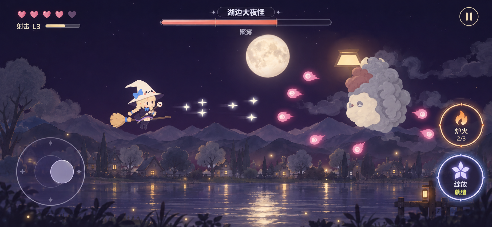
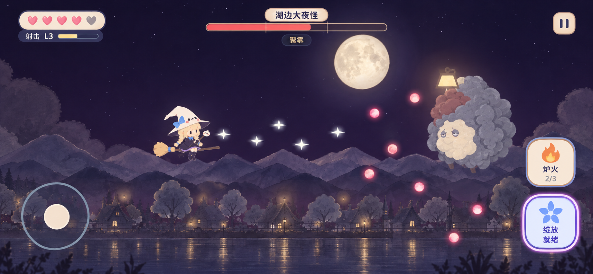

# 游玩主界面 UI 视觉提案 v1.0.0

日期：2026-10-23。范围：横屏战斗界面的两种视觉方向，以及电脑、手机、平板的适配要求。

本次使用内置 imagegen 生成两张独立效果图。它们是美术与布局参考，不是运行截图，也不是已经完成的响应式界面。尚未选定方案；当前游戏与 v1.9.0 修改文档保持原样。生成提示词完整保存于同目录的「生成提示词.json」。

## 两个方向

### A：月光悬浮

透明深紫底、细线与圆形按钮，炉火用暖橙、绽放用淡蓝紫。左上信息直接浮于夜景，中央 Boss 血条细长，整体轻盈。适合突出背景与飞行空间。

### B：童话徽章

奶油色圆角徽章、深蓝紫文字、柔和纸质边缘。生命和射击成长成组，右侧两枚技能按钮保持一致造型，火焰与星花图标区分技能。手机上的信息识别更直接，气质接近主角的可爱造型。

两版共同的信息排布：左上生命与射击成长；上方中央阶段信息，Boss 出现时显示名称、单根血条与三阶段刻度；右上暂停；手机左侧移动摇杆，右侧炉火和绽放上下成组。炉火次数直接放在炉火按钮内，绽放能量、就绪或持续倒计时直接放在绽放按钮内。触屏普通射击自动进行。

## 视觉图落地时的校准

- 两张图都以手机横屏比例表现构图，图中控件是生成式视觉近似。摇杆、按钮、间距和安全边距以实际 CSS 尺寸与最新修改文档为准，不能量取图片像素后直接固定。
- 概念图的外圈与发光为表达状态而加强。实际游戏缩减摇杆外圈装饰与绽放光晕，敌弹、Boss 预警和玩家轮廓保持更高的识别优先级。
- 炉火与绽放分别使用火焰和星花图标；图标是实时按钮的一部分，文字和数值独立绘制。炉火仅在击破灯怪后补充，绽放使用自身能量；UI 始终跟随真实状态。
- 背景、主角、敌人继续使用项目已有素材。两张图中的背景重绘和敌弹示意仅为衬托界面，不代表要重做场景、主角、Boss 或攻击方式。
- 字体、按钮背景、图标可独立实现，整张效果图不作为一张全屏界面图片使用。

## 通常采用的适配方式

共用一套玩法和碰撞逻辑，把背景、战斗核心、操作 UI 分成三层处理。背景覆盖容器并自然延展；480×270 的战斗核心等比缩放、完整可见；UI 按设备可用空间与输入方式重新排布。手机与电脑的按钮不随整张游戏画面一起缩小。

屏幕品牌和物理分辨率不能决定布局。以页面实际可见的 CSS 宽高、安全区域和输入能力计算布局；像素密度只用于改善画布清晰度。全屏模式可选，普通浏览器模式也应能使用。

| 内容 | 电脑 | 手机横屏 | 平板横屏 |
| --- | --- | --- | --- |
| 背景 | 覆盖游戏容器 | 覆盖实际可见区域 | 自然延展到额外空间 |
| 战斗核心 | 保持 480×270 逻辑尺寸并等比完整显示 | 同一核心，避开侧边控件 | 同一核心，上下可增加装饰背景 |
| 生命与成长 | 左上 | 左上紧凑显示 | 左上，适当增大 |
| 阶段/Boss | 顶部中央，Boss 条位于阶段信息下 | 顶部中央紧凑显示 | 顶部中央 |
| 分数 | 右上，靠近暂停 | 战斗时收起实时分数，在暂停/结算中可见 | 空间足够时显示 |
| 操作 | 键盘，左下炉火/绽放 64×64，间隔 16 | 左侧 56 摇杆；右侧两枚 56×56 按钮竖排，间隔 12 | 左下 80 摇杆；右下两枚 72×72 按钮横排，间隔 16 |
| 竖屏/过小窗口 | 小窗口使用紧凑布局或暂停提示 | 保留状态并暂停，提示横屏；回横屏后主动点继续 | 同样保留状态并暂停 |

## 可以直接发给 DeepSeek 的要求

请帮我完成这个横屏网页游戏的电脑、手机和平板尺寸适配，并按我选定的 UI 参考图落实界面。先检查现有适配代码，在现有项目基础上完善。

游戏入口：原工程/index.html。

相关源文件：原工程/src/game.src.js、原工程/src/shell.html。构建工具：原工程/tools/build.py。先确认构建关系，备份当前可玩版本，再同步修改源文件和构建后的入口。

玩法与跨设备布局依据：设计工程/design/第一关修改文档-v1.9.0/第一关修改说明.md。

视觉参考：我选定的「方案A-月光悬浮.png」或「方案B-童话徽章.png」。参照按钮造型、配色、信息层级和排布，继续使用游戏现有背景、主角、敌人素材。按以下要求实现：

1. 一套游戏逻辑支持电脑、手机、平板。世界逻辑坐标保持 480×270，角色速度、碰撞、敌人出现距离、弹速和关卡节奏一致。背景覆盖全屏，核心战斗视野等比完整显示，UI 独立布局与缩放。按钮和手指区域避开主要交战区，保持敌人和攻击预警可见。
2. 布局以实际可见的 CSS 宽高、安全边距和输入能力判断。处理刘海、圆角、底部手势区、浏览器工具栏与地址栏变化；已有 VisualViewport 与 safe-area 相关逻辑先核对再完善，并提供不支持时的回退。Canvas 像素密度处理只改善清晰度，不改变逻辑坐标或触摸坐标。普通浏览器模式和可用的全屏模式都要适配。
3. 只保留炉火、绽放两个技能按钮。炉火按钮显示 0/3～3/3；只有击破灯怪才补充，奖励火种准确飞入实际炉火按钮的库存位置。绽放按钮显示自己的能量、就绪和持续倒计时。不要添加其他魔法、选中态、切换键或通用魔力条。本次保持已确定的战斗规则。
4. 电脑保留键鼠操作，左上生命/射击成长，顶部中央阶段/Boss，右上分数/暂停。左下两枚技能按钮为 64×64 CSS 像素，间隔 16，显示快捷键。手机横屏左侧 56 摇杆、右侧两枚 56×56 技能按钮上下排列、间隔 12，触屏自动射击，不常驻分数和秒数。平板左下 80 摇杆、右下两枚 72×72 技能按钮横排、间隔 16。尺寸适配遵循 v1.9.0 的空间预留与核心最小尺寸，其他可点击控件触摸目标至少 44×44，文字在实际设备上可读。
5. 支持双指同时移动和点技能，独立追踪指针。游戏操作区域不触发页面滚动或误选文字，菜单需要时可滚动。手指滑过另一个按钮不应误放技能。旋转、暂停、切后台、取消触摸时清理按下状态，避免持续移动或重复扣次数。
6. 调整浏览器窗口、切换横竖屏、地址栏展开或收起时重新计算布局和坐标映射。切成竖屏或空间不足时保留当前进度并暂停，显示横屏/扩大窗口提示；恢复有效尺寸后由玩家主动点击继续。普通尺寸变化不重置关卡，布局变化不改变奖励到账结果。
7. 参考图只决定视觉方向。图中的摇杆装饰、按钮光晕要按手机尺寸收敛；敌弹和 Boss 危险预警必须清晰。文字、数值、按钮状态、血条都是实时 UI。不要将整张参考图贴进游戏代替界面。
8. 验证电脑 960×540、1366×768、1920×1080；手机横屏 568×320、667×375、844×390、915×412；平板 1024×768。额外检查 844×390 中模拟左右各 47、底部 21 的安全区域，以及 390×844 竖屏和 540×260 小窗口。上述尺寸为 CSS 可视区域。568×320 按无额外安全占用检查；可用空间不足时按规则暂停提示，不能硬挤界面。
9. 各尺寸检查主角与完整战斗视野、按钮可点范围、UI 重叠、暂停/结算弹窗、火种飞入炉火按钮的位置；实际操作同时移动与施法，并检查布局变化后的恢复。提供目标尺寸截图、修改文件清单、测试结果。明确区分浏览器模拟测试和 Android/iOS 真机测试；没有真机条件就注明未测项目。

请直接完成实现与验证，交付仍可游玩的入口文件。先反馈最终采用的布局方案和必要取舍，发现与上述要求冲突时具体说明。

## 实现参考

MDN：VisualViewport（实际可见区域与其变化）：https://developer.mozilla.org/en-US/docs/Web/API/VisualViewport

MDN：CSS env / safe-area-inset（安全边距）：https://developer.mozilla.org/en-US/docs/Web/CSS/Reference/Values/env

MDN：devicePixelRatio（画布像素密度）：https://developer.mozilla.org/en-US/docs/Web/API/Window/devicePixelRatio

本次交付仅为效果图和要求说明；尚未进行上述运行、触摸或真机验收。
